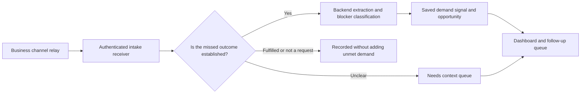

# Automatic request capture

The product interface shows business activity, demand, customer evidence and follow-ups. Model versions, training, experiments and evaluation stay in backend code and the training notebook. `/present` now redirects to `/demo#activity`; old presentation bookmarks no longer open an ML lesson.

## Data flow



Incoming events are analysed on the server during the receiver request. No preview, save button or browser model is required. The dashboard refreshes its operational data every eight seconds while visible; it pauses rendering updates while someone edits a form or dialog.

This implementation processes events inline, rather than claiming a hosted background queue. Each valid event is recorded before analysis. Successful signal creation and its intake result commit together. A processing failure is retained as **Needs retry** and returns HTTP 503. The relay should retry the same event ID with backoff. The application also provides a retry action in Channel activity.

## Configure a real business channel

1. Set a strong random `GHOST_INGEST_TOKEN` in the server environment, including the Render service's Environment settings. Keep it in the business relay's secret store too. Do not place it in browser JavaScript or a public chatbot widget.
2. Configure the channel's existing backend or automation to forward an event to `POST /api/ingest/<channel>` with `Authorization: Bearer <token>` and JSON content type. Verify the original provider's webhook signature in that relay before forwarding it.
3. Supply a stable request/event ID. Include enough conversation context to establish what happened. For multi-message conversations, forward request-level events or assign one stable ID per confirmed request: individual messages are not necessarily separate buying intents. The conversation reference is retained; it is not semantic deduplication. Use a new event ID for a genuinely new event or changed event content.
4. Check Channel activity. **Events received** means the app has received events for that channel; it does not verify a provider account connection. If the token is absent, live intake is disabled with HTTP 503. An invalid token returns HTTP 401.

| Channel path | Input | Real integration needed |
| --- | --- | --- |
| `whatsapp` | Message/conversation text | Your messaging provider's server-side forwarding |
| `email` | Extracted enquiry/conversation text | Your business email forwarding or automation |
| `chatbot` | Text and available conversation outcome | A server-side chatbot event handler |
| `sales_notes` | Saved sales-note text | Your sales system's saved-note callback |
| `voice_notes` | Completed `transcript` | Your voice service's transcription callback |
| `website_search` | Text and non-negative `results_count` | Website search events |
| `stockout` | Product and optional quantity | Store/inventory events |
| `rejected_quote` | Text | An explicit rejected-quotation event |
| `abandoned_enquiry` | Text | An established abandoned-enquiry event |

The app cannot read a person's WhatsApp or email just because a label appears in the interface. This update does not connect accounts, fetch private inboxes, download audio or implement speech recognition. The authenticated receiver is provider-neutral; each real channel still needs its forwarding setup. Existing manual/prototype APIs remain available and are distinct from the authenticated relay contract.

### Example event

```json
{
  "event_id": "business-message-143",
  "conversation_id": "conversation-24",
  "text": "Customer requested 2 wireless earbuds but they are sold out. Total budget KES 6,000.",
  "customer": "customer-reference-7",
  "currency": "KES",
  "outcome": "unmet"
}
```

Send it from the relay's backend, with its secret already in the environment:

```sh
curl --fail-with-body "$GHOST_APP_URL/api/ingest/whatsapp" \
  -H "Authorization: Bearer $GHOST_INGEST_TOKEN" \
  -H 'Content-Type: application/json' \
  --data-binary @event.json
```

`event_id` and text are required for message channels. Voice uses `transcript` instead of `text`. Optional fields are `conversation_id`, `customer`, `currency`, `outcome`, `product` and `qty`. Structured product/quantity context can come from the business system; the relay cannot supply `reason`, `fields`, `reviewed_reason` or `verified` to manufacture training labels.

The optional outcome is one of `unmet`, `pending`, `fulfilled`, `not_a_request`. Explicit pending outcomes are held for context. Fulfilled/non-request events do not add missed demand. Without an outcome, a conservative text check looks for explicit blockers; an ordinary “Do you have earbuds?” stays in Needs context. This eligibility check is a limited rule set, not a validated semantic detector. Reviewer corrections and representative business evaluation remain necessary.

### Retry contract

- Same channel + event ID + normalized content: reuse the event and signal; count once.
- Same ID with changed content: HTTP 409; the original is preserved.
- Analysis failure: HTTP 503; retry with the same ID, or use Retry analysis.
- Needs context: do not count as missed demand until a team member confirms the outcome.
- Confirming a missed outcome does not verify the classifier's blocker label. Automatic captures remain unreviewed training examples until a person verifies the blocker separately.

## Backend models

The existing TF-IDF + logistic regression blocker classifier runs server-side. Feature extraction, parsing, product grouping and business suggestions also run on the backend. Inference metadata remains available for backend diagnostics; the business frontend does not request model-status/training endpoints or render experiment metrics.

On local application startup or Gunicorn startup, `bootstrap_models()` initializes missing demand baseline artifacts from the included synthetic starter set. It never overwrites an existing artifact and can be disabled with `GHOST_BOOTSTRAP_MODELS=0`. A supplied evaluated model can be selected with `GHOST_ML_PATH`. Low-score or unavailable-model behaviour still uses the existing fallback. This does not automatically retrain on incoming events or promote the separate notebook candidate.

Training, evaluation, language coverage, model versioning and deployment comparisons remain in `notebooks/GhostDemand_Training_Improved.ipynb` and `ml_workflow/`. The included practice data and notebook metrics do not establish accuracy on real business requests.

## Try the operational demo

Open `/demo#activity` and select **Send sample channel events**. Five fixed synthetic events pass through the same normalization, eligibility and analysis functions used by the live receiver. Four create demand signals; one availability question needs context. Repeating the sample reuses event IDs. The live database and real accounts are untouched.

For a real integration test, use a separate database and test relay token. The app remains a single-workspace hackathon prototype: business-user authentication, tenant isolation, verified order links and durable hosted storage are separate deployment requirements. On a service without persistent storage, SQLite records and generated artifacts do not survive replacement of the runtime filesystem. Do not describe the current demo as a production multi-tenant service.
